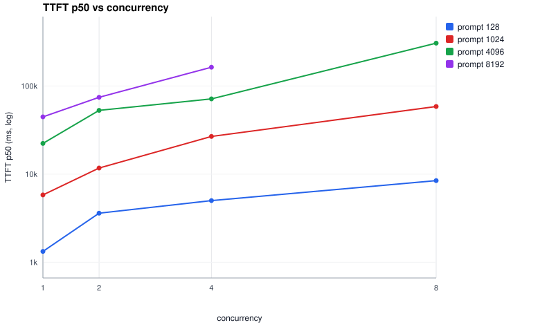
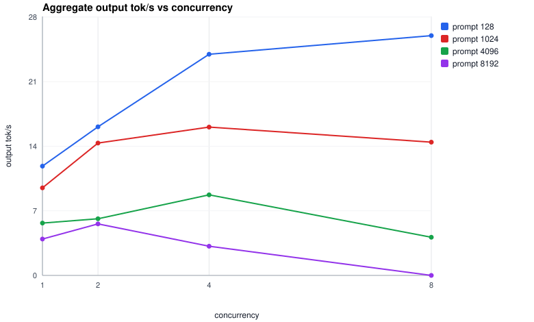
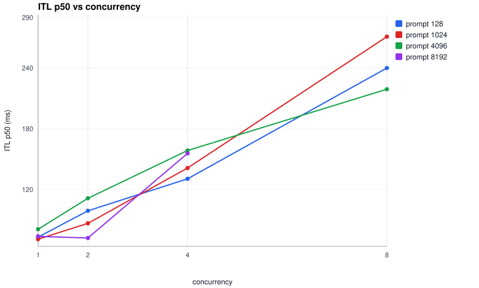
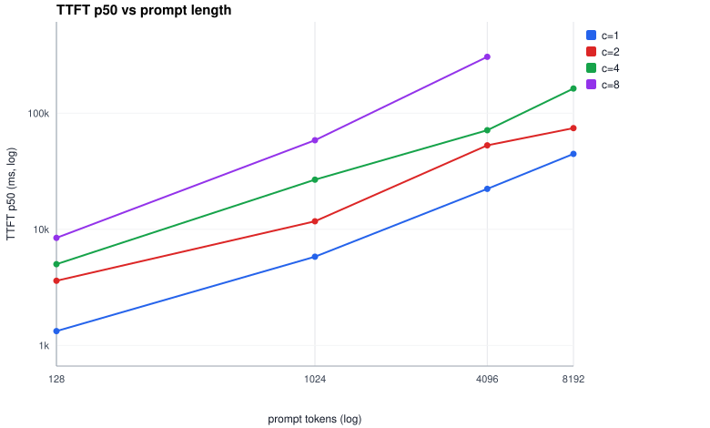

# Prompt length × concurrency on MLX-LM — M5, Qwen3.5-9B-4bit

First principal study of the inference-lab experiment runner: how do TTFT,
ITL and throughput move when prompt length (128 → 8K tokens) and client
concurrency (1 → 8) vary, everything else held constant?

- **Worker**: MLX-LM `mlx_lm.server` 0.31.3, `mlx-community/Qwen3.5-9B-4bit`
- **Path**: loadgen → gateway (127.0.0.1:8080, LOR policy) → worker (127.0.0.1:8082)
- **Machine**: MacBook Air M5, 24 GB unified memory, macOS 27.0, on power
- **Run**: `benchmarks/results/mlx-prompt-concurrency-20260923-203336/`
  (raw JSON/CSV per run; curated copy: `mlx-prompt-concurrency-matrix.json`
  next to this file). Total wall: 1.4 h including warmup and cooldowns.
- **Noise caveat**: the Docker observability stack and a few unrelated
  containers were running (load average ~23 while generating — MLX's
  Metal submission threads dominate that number). All comparisons are
  internally consistent: same machine state throughout.
- **Reproduce**: `make worker-mlx`, `make gateway`, `make matrix
  MATRIX=mlx-prompt-concurrency`, `make analyze STUDY=<printed dir>`

## Design

16 measured runs = prompt {128, 1K, 4K, 8K} × concurrency {1, 2, 4, 8},
output fixed at 256 `max_tokens`, streaming, burst arrivals (all requests
released at once, closed-loop cap = concurrency). Prompts are synthetic
prose, **unique per request** (`shared_prefix_tokens = 0`), so every
request pays a full prefill — a *prefix-cache-miss* study by design;
prefix hits are a separate experiment.

- `num_requests` = 8 per run (16 at c=8, so c=8 gets two full waves)
- 1 warmup run (3 requests) before measurement, discarded — first-request
  TTFT is ~5 s while kernels/weights page in vs ~0.7–1.3 s warm
- 5 s cooldown between runs; per-request timeout 900 s
- The model is a *thinking* model: reasoning deltas count as tokens (a
  token is a token for latency), so `max_tokens=256` may be spent mostly
  on reasoning — fine for timing, irrelevant for content
- Token counting is client-side (1 streamed chunk ≈ 1 token) — the
  latency the user experiences, through one gateway hop

## Results

### TTFT p50 / p95

| c\prompt | 128 | 1K | 4K | 8K |
| --- | ---: | ---: | ---: | ---: |
| 1 | 1.33s / 1.80s | 5.81s / 7.63s | 22.3s / 24.3s | 44.6s / 54.2s |
| 2 | 3.60s / 4.11s | 11.7s / 12.2s | 52.9s / 57.2s | 74.4s / 82.8s |
| 4 | 5.01s / 6.11s | 26.8s / 28.6s | 71.4s / 77.5s | 163.1s / 278.1s |
| 8 | 8.44s / 8.69s | 58.5s / 58.5s | 306.2s / 306.7s | **timed out** |

### ITL p50

| c\prompt | 128 | 1K | 4K | 8K |
| --- | ---: | ---: | ---: | ---: |
| 1 | 73 | 71 | 81 | 74 |
| 2 | 99 | 87 | 111 | 72 |
| 4 | 131 | 141 | 159 | 156 |
| 8 | 240 | 271 | 219 | n/a |

### Aggregate throughput and per-stream experience

| prompt | c | tok/s | ×c1 | TTFT p50 ×c1 | stream tok/s p50 | ok |
| --- | --- | ---: | ---: | ---: | ---: | ---: |
| 128 | 1 | 11.8 | 1.00 | 1.00 | 11.8 | 8/8 |
| 128 | 2 | 16.1 | 1.36 | 2.72 | 8.4 | 8/8 |
| 128 | 4 | 24.0 | 2.02 | 3.78 | 6.0 | 8/8 |
| 128 | 8 | 26.0 | 2.19 | 6.36 | 3.7 | 7/16 |
| 1K | 1 | 9.5 | 1.00 | 1.00 | 9.5 | 8/8 |
| 1K | 2 | 14.3 | 1.51 | 2.02 | 7.1 | 8/8 |
| 1K | 4 | 16.1 | 1.69 | 4.61 | 4.0 | 8/8 |
| 1K | 8 | 14.4 | 1.52 | 10.06 | 1.9 | 9/16 |
| 4K | 1 | 5.7 | 1.00 | 1.00 | 5.8 | 8/8 |
| 4K | 2 | 6.1 | 1.08 | 2.37 | 3.0 | 8/8 |
| 4K | 4 | 8.7 | 1.54 | 3.20 | 2.2 | 8/8 |
| 4K | 8 | 4.1 | 0.73 | 13.72 | 0.7 | 6/16 |
| 8K | 1 | 3.9 | 1.00 | 1.00 | 3.9 | 8/8 |
| 8K | 2 | 5.6 | 1.42 | 1.67 | 2.7 | 8/8 |
| 8K | 4 | 3.2 | 0.80 | 3.66 | 0.8 | 8/8 |
| 8K | 8 | 0.0 | — | — | — | **0/16** |

## Findings

**1. Prefill cost is linear in prompt length: ~5.3 ms/token.**
At c=1, TTFT fits `TTFT(p) ≈ 0.75 s + 5.35 ms × p` across all four sizes
(0.75+5.35·8.192 = 44.6 s — exactly the measured 8K point). That is
~190 prefill tok/s for a 9B-4bit model on this M5 under this machine
state. Decode, by contrast, is flat **regardless of prompt length**
(ITL p50 71–81 ms at c=1 for 128 → 8K): a *generated* token costs ~13×
a *prefilled* one, because prefill processes the whole prompt in large
parallel passes while decode runs one forward pass per token.

**2. Concurrency buys queueing, not batching.**
`mlx_lm.server` 0.31.3 has no continuous batching: concurrent generations
time-slice a single GPU. Evidence: per-stream ITL rises ~with in-flight
count (73 → 240 ms at 128-tok prompts, c1 → c8) while aggregate
throughput improves only 2.2× at 8× the load. TTFT grows 6.4–13.7× —
every queued request pays full prefill *plus* its slice of everyone
else's decode. The extreme: 8K × c4 shows ITL p99 of **10.4 s** —
a stream starving while the server works on others.

**3. The knee moves left as prompts grow.**
Peak aggregate throughput sits at c=8 for 128-tok prompts (26 tok/s,
still rising), c=4 for 1K (16.1), c=4 for 4K (8.7), c=2 for 8K (5.6).
Past the knee, throughput *regresses below c=1* (4K c8: 0.73×; 8K c4:
0.80×) — scheduling overhead and memory pressure make the server less
efficient with more in-flight work than a single stream. Long-prompt
workloads saturate the prefill path at very low concurrency.

**4. There is a hard failure cliff.**
At c=8 the second burst wave queues behind the first and outlives the
900 s per-request timeout: 7/16, 9/16, 6/16 requests survive for
128/1K/4K prompts. At 8K × c8 **nothing survives**: all 16 requests were
still waiting for their first token when the client aborted them at the
900 s timeout — zero tokens received in 15 minutes. Under a 900 s SLA
the sustainable admission on one mlx-lm worker is ≈ c≤4 for ≤1K
prompts, ≈ c2 at 4K, c1 at 8K — with a tighter SLA (say 60 s TTFT) it
collapses to c≤2 / c2 / c1 / c1.

**5. Users feel saturation before the operator does.**
At 128-tok prompts, going c1 → c8 drops each user's stream from 11.8 to
3.7 tok/s (3.2× slower) while the *system* gains only 2.2× total
throughput. Individual-experience metrics (stream tok/s, ITL p99)
degrade earlier and harder than aggregate ones — exactly why a gateway
should do admission control instead of letting queues build on the
worker.

### Capacity-planning takeaway

> On a single MLX-LM worker (M5, 9B-4bit), admit roughly one in-flight
> long-prompt request or a handful of short ones; everything else should
> wait at the gateway with visibility, not pile onto the GPU. The
> scheduler experiment that follows: an admission/ECT policy that
> caps worker in-flight requests by prompt-length class.

## Caveats

- One run per configuration (8 or 16 requests); methodology prefers ≥3
  repeats with medians — queued as follow-up. p95/p99 within a run are
  indicative, not settled.
- Generation sampled at temperature 1.0 → completion lengths vary a
  little (avg ~254 tokens across all runs; throughput divides by wall
  so it stays comparable).
- Client-side clock, one gateway hop included; first-run model effects
  excluded via warmup. MacBook Air is fanless — sustained 1.4 h load
  means later runs ran warmer; per-run cooldowns (5 s) help but don't
  fully remove thermal drift.
- Thinking-model reasoning tokens are counted as tokens.

## What this does *not* yet explain

Client-side timing shows the *symptom* (queueing, slower decode), not
the *cause* (is the worker time-slicing generations? serializing
prefill? waiting on a lock?). Answering that needs the server-side
per-request timeline (queue_enter/exit, tokenize, prefill, first_token)
plus OTel tracing through the gateway — the next phase of the runner.

Follow-ups queued: repeat runs for variance; prefix-cache variant
(`shared_prefix_tokens`); Poisson arrivals; streaming off; the same
matrix on llama.cpp and vLLM-Metal for the cross-runtime comparison.
